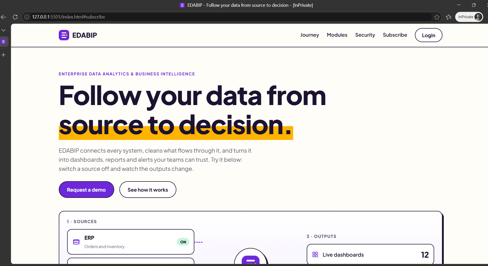

# EDABIP – Enterprise Data Analytics & Business Intelligence Platform

A responsive landing page for a business intelligence platform, built with plain HTML, CSS and JavaScript (no frameworks or libraries).



## Features
- Page content loaded from JSON files with `fetch` and `async/await`, with loading, error (with "Try again") and empty states
- Sticky header with smooth-scroll navigation; the link of the section you are reading is highlighted (IntersectionObserver)
- **Request Demo** dialog with field-by-field validation and a success message
- Newsletter form with email validation (empty, wrong format, already subscribed)
- Interactive data-flow demo in the hero, "How it works" tabs (arrow keys), module search and filter, security accordion
- The page remembers your actions after a refresh (localStorage)
- Sections fade in as you scroll (IntersectionObserver); turned off automatically for people who prefer reduced motion
- Mobile hamburger menu (closes on link click, outside tap, Escape, or when the window grows); responsive layout; keyboard accessible
- Code split into ES modules

## How to run
ES modules and `fetch` do **not** work when you double-click `index.html`. Use a local server:

**Option 1 – VS Code Live Server**
1. Open the folder in VS Code.
2. Right-click `index.html` and choose **Open with Live Server**.

**Option 2 – Python**
```bash
python -m http.server 8000
```
Then open http://localhost:8000

No installation or build step is needed.

## Project structure
```
index.html
css/
  style.css
js/
  main.js          entry point
  api.js           fetches the JSON files
  status.js        loading / error / empty states
  dom.js           shared DOM helpers
  storage.js       safe localStorage helpers
  validators.js    form validation rules
  form-utils.js    shows a validation message for one field
  menu.js          mobile hamburger menu
  scroll-nav.js    smooth scroll + active link on scroll
  demo-modal.js    Request Demo dialog
  forms.js         newsletter form and login dialog
  reset.js         "Reset saved data" button
  fade-in.js       fade-in of sections on scroll
  hero-flow.js     interactive data-flow demo
  journey.js       "journey" tabs
  modules.js       module search + filter
  security.js      security accordion
data/
  sources.json  stages.json  modules.json  pillars.json
assets/
  icons.svg  logo.svg  screenshot-task1.png
```

## What each module does
| File | Responsibility |
|---|---|
| `main.js` | Imports every part of the page and starts it |
| `api.js` | One `fetchList` function that loads and checks a JSON file; one small loader per data file |
| `status.js` | `loadSection` shows "Loading…", then renders the data, or shows an empty or error message with a retry button |
| `dom.js` | `$`, `escapeHtml`, `icon`, `setMessage`, `animateNumber`, `enableBackdropClose` used by many modules |
| `storage.js` | `loadState`, `saveState`, `removeState`, `clearAllState`. Every call is in `try/catch`, so the page still works if storage is blocked or full |
| `validators.js` | One function per rule (`validateEmail`, `validateName`, `validateCompany`, ...). Each returns an error message or an empty string |
| `form-utils.js` | Shared form helpers: `checkField` (validate one field), `checkAll` (validate all and return the first wrong one), `watchFields` (re-check while typing), `clearAll` |
| `menu.js` | Opens and closes the mobile menu (button, link click, tap outside, Escape key, window resize) |
| `scroll-nav.js` | Smooth scrolling for in-page links, focus moves to the section, and an IntersectionObserver marks the current link with `aria-current` |
| `demo-modal.js` | Request Demo dialog: validation, success message, and saving, editing and withdrawing the request |
| `forms.js` | Newsletter form (remembers the subscribed email) and the login dialog |
| `reset.js` | Footer button that clears everything saved in localStorage |
| `fade-in.js` | Adds a fade-in to the sections marked `data-reveal` the first time they scroll into view |
| `hero-flow.js`, `journey.js`, `modules.js`, `security.js` | Render one page section each from its JSON data and remember the person's choices |

## What is saved in localStorage
All keys start with `edabip:`.

| Key | What it keeps | Action |
|---|---|---|
| `demoRequest` | The latest demo request (name, email, company, team size, message, date) | Created when you send, edited with "Edit request", deleted with "Withdraw" |
| `subscribedEmail` | The newsletter email | Created when you subscribe |
| `activeSources` | Which data sources are switched on in the hero | Setting changed |
| `journeyStage` | The selected tab in "The journey" | Setting changed |
| `moduleFilters` | The module search text and the selected category | Setting changed |

Use **Reset saved data** in the footer to clear all of them. Only dummy data is used. No real passwords or card numbers are collected.

## Validation rules (Request Demo)
- **Full name:** required, at least 2 characters, letters, spaces, dots, apostrophes and hyphens only
- **Work email:** required, valid format
- **Company:** required, at most 60 characters
- **Team size:** required choice
- **Message:** optional, at most 300 characters
- **Consent:** the box must be ticked

Errors appear under each field, the first wrong field gets focus, and a field is checked again while you fix it.

## Testing the loading, error and empty states
- **Error:** rename a file in `data/` (for example `modules.json`) and refresh. That section shows an error message and a "Try again" button; the rest of the page keeps working.
- **Empty:** change a JSON file to `[]`.
- **Loading:** `js/api.js` has `DEMO_DELAY_MS`, which is `0`. Set it to `1000` to see the "Loading…" message for one second, or use DevTools > Network > Slow 3G.

## Accessibility
Built in: a skip link, one `h1` with ordered headings, labelled form fields, error messages linked to their fields (`aria-describedby`, `aria-invalid`), visible focus outlines, keyboard support for the menu, tabs, accordion and dialogs, `aria-current` on the active nav link, enough colour contrast, and reduced-motion support.


### Lighthouse accessibility score
Score: 100 (Lighthouse in Edge, Accessibility, Desktop, 16 Oct 2026)
Score: _to be added_


### Task 1 notes
The hardest part was making the layout responsive. The card grids looked fine on desktop but broke on mobile until I learned to use media queries and CSS grid. I also found it difficult at first to set up Git and push my code to GitHub, because I had to sign in and connect the repository.